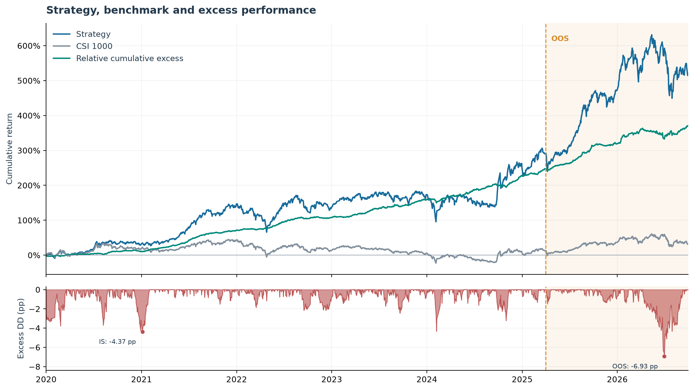

# Live_Signal

## Live Signal Tracking Methodology

- Model updates: Quarterly retraining; historical out-of-sample signals remain unchanged.
- Rebalancing: Daily, using VWAP of the first half hour as the assumed execution price.
- Exclusions: ST stocks, suspended stocks, stocks newly listed in the current quarter, and stocks with fewer than 40 trading days in the past 60 trading days.
- Transaction costs: Evaluated at 5 and 15 bps.
- Turnover: Reported on a one-way basis.
- Optimizer: Constrains active exposures to eight **Barra style factors to ±0.3** relative to the benchmark and penalizes risk using **stock-specific risk** and **Barra style-factor covariance**. Enforces full investment, long-only positions, a 0.5% per-stock weight cap, a 15% one-way turnover limit, and per-stock liquidity limits.

## Signal Performance

In sample period: January 2, 2020–September 30, 2026.  
OOS period: April 1, 2025–September 30, 2026.  

### Strategy, Benchmark and Excess Performance

| Metric | In-sample | OOS |
|---|---:|---:|
| Trading observations | 1,269 | 367 |
| Annualized arithmetic excess | 24.39% | 20.81% |
| Information ratio | 4.09 | 3.37 |
| Maximum additive excess drawdown | 4.37 pp | 6.93 pp |
| Positive excess months | 90.48% | 88.89% |

Daily strategy returns are calculated as daily excess plus benchmark
returns. Strategy and benchmark curves are compounded. Relative cumulative
excess equals strategy wealth divided by benchmark wealth, minus one.
Additive excess drawdown is measured in percentage points (pp).

## Return Decomposition

### Cumulative Return Attribution

| Cumulative contribution (pp) | IS | OOS |
|---|---:|---:|
| 20 style factors | +37.29 | +12.07 |
| Industry / country | +5.43 | −0.74 |
| Model residual | +97.73 | +25.11 |
| Costs | −14.11 | −5.27 |
| **Net excess return** | **+126.33** | **+31.17** |

### Overall Return Decomposition

### Contributions from 20 Barra Style Factors

### Rolling Performance and Drawdown

The maximum OOS additive excess drawdown is 6.93 pp, from the
June 1, 2026 peak to the June 30, 2026 trough. The previous peak
is recovered on September 4, 2026.

At September 30, 2026, the trailing 63-day information ratio is 3.65,
compared with 3.31 for the full OOS period. Rolling windows use
63 observations and may span the IS/OOS boundary.

Illustrative supplied-series analysis. OOS denotes the specified date
segment, not independent live validation. The supplied return file does
not identify a transaction-cost scenario.

## Part Two: Incremental Contribution

Sample period: January 2, 2020–September 30, 2026.  
OOS period: April 1, 2025–September 30, 2026.

### Improvement over the Company Baseline

| OOS metric | Company baseline | Combined signal | Change |
|---|---:|---:|---:|
| Annualized excess return | 21.42% | 24.38% | +2.96 pp |
| Information ratio | 3.74 | 4.52 | +0.78 |
| Maximum additive excess drawdown | 4.93 pp | 5.26 pp | +0.33 pp |
| Cumulative additive excess | 33.59 pp | 36.55 pp | +2.96 pp |

The combined signal delivers higher excess return and better
risk-adjusted performance than the company baseline. Tracking error
decreases, although maximum additive excess drawdown widens slightly.

Changes are calculated before rounding. Annualization assumes
250 trading days; pp denotes percentage points.

| Metric | In-sample | OOS | Full sample |
|---|---:|---:|---:|
| Trading observations | 1,269 | 367 | 1,636 |
| Daily excess-return correlation | 0.519 | 0.580 | 0.534 |
