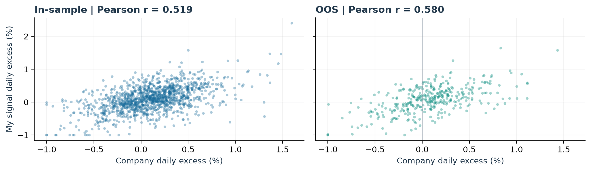
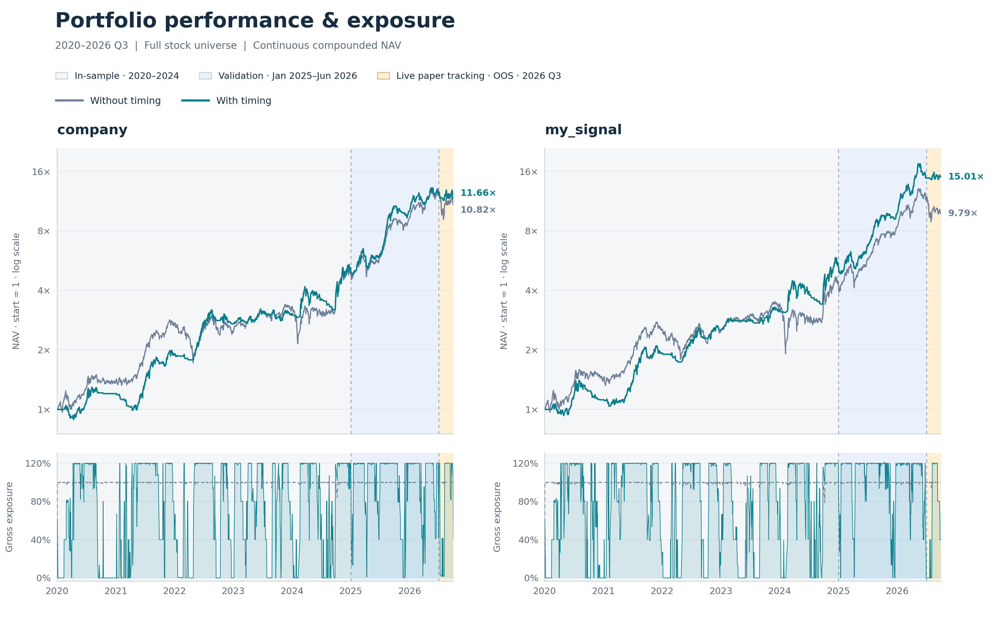
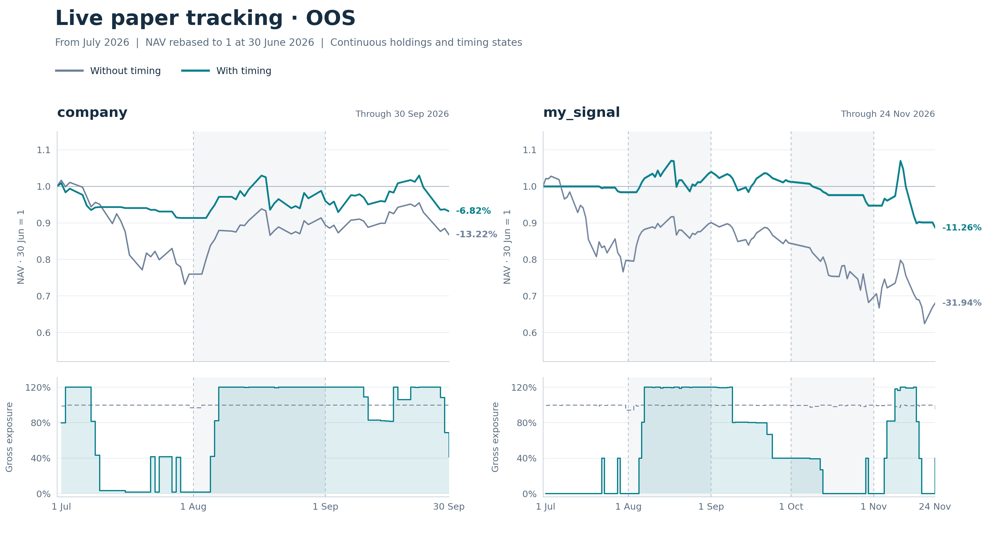

# Live_Signal

## Live Signal Tracking Methodology

- Model updates: Quarterly retraining; historical out-of-sample signals remain unchanged.
- Rebalancing: Daily, using VWAP of the first half hour as the assumed execution price.
- Exclusions: ST stocks, suspended stocks, stocks newly listed in the current quarter, and stocks with fewer than 40 trading days in the past 60 trading days.
- Transaction costs: Evaluated at 15 bps both sides.
- Turnover: Reported on a one-way basis.
- Optimizer: Constrains active exposures to eight **Barra style factors to ±0.3** relative to the benchmark and penalizes risk using **stock-specific risk** and **Barra style-factor covariance**. Enforces full investment, long-only positions, a 0.5% per-stock weight cap, a 15% one-way turnover limit, and per-stock liquidity limits.

## Signal Performance

In sample period: January 2, 2020–September 30, 2026.  
OOS period: April 1, 2025–September 30, 2026.  

### Strategy, Benchmark and Excess Performance

| Metric | In-sample | OOS |
|---|---:|---:|
| Trading observations | 1,269 | 367 |
| Annualized arithmetic excess | 24.39% | 20.81% |
| Information ratio | 4.09 | 3.37 |
| Maximum additive excess drawdown | 4.37 pp | 6.93 pp |
| Turnover | 13.30 % | 14.54% |

## Excess Return Drawdown Analysis

### 1. Loss Attribution

The three episodes below have residual return max drawdown greater than 3 percentage points (pp).

| Episode | Loss window | Total loss (pp) | 20 style factors (pp) | Industry / country (pp) | Costs (pp) | Residual (pp) |
|---|---|---:|---:|---:|---:|---:|
| **OOS-1** | Apr 9–Jun 30, 2026 | **−6.930** | −0.560 | −1.297 | −0.925 | −4.147 |
| IS-1 | Dec 4, 2020–Jan 4, 2021 | **−4.370** | −0.223 | −0.273 | −0.071 | −3.803 |
| IS-2 | Sep 23–Oct 31, 2024 | **−3.236** | +0.558 | +0.344 | −0.339 | −3.799 |

### 2. Market Conditions During Residual-Loss Episodes

| Market characteristic | OOS-1 | IS-1 | IS-2 |
|---|---|---|---|
| Loss window | Apr 9–Jun 30, 2026 | Dec 4, 2020–Jan 4, 2021 | Sep 23–Oct 31, 2024 |
| **Outperformer-group analysis** | | | |
| CSI 1000 return | +10.73% | +1.30% | +37.04% |
| Median constituent return | −15.20% | −5.75% | +28.82% |
| Outperformers beating the index | 22.7% | 28.6% | 36.6% |
| Breadth percentile | 0.13th | 1.36th | 19.48th |
| Average benchmark weight in outperformers (%) | 35.078 | 35.572 | 38.002 |
| Average portfolio weight in outperformers (%) | 20.698 | 17.485 | 16.744 |
| Average active weight in outperformers (pp) | −14.380 | −18.087 | −21.258 |
| Outperformers’ model-residual contribution (pp) | −4.436 | −2.677 | −2.734 |
| **Trading-activity-group analysis** | | | |
| Trading amount in busiest 5% | 35.55% | 32.74% | 33.87% |
| Concentration percentile | 97.47th | 67.08th | 78.05th |
| Average benchmark weight in busiest 5% (%) | 14.802 | 9.298 | 9.193 |
| Average portfolio weight in busiest 5% (%) | 6.878 | 3.014 | 2.015 |
| Average active weight in busiest 5% (pp) | −7.924 | −6.284 | −7.178 |
| Busiest 5% model-residual contribution (pp) | −3.402 | −1.787 | −2.251 |

## Incremental Contribution

Sample period: January 2, 2020–September 30, 2026.  
OOS period: April 1, 2025–September 30, 2026.

### Improvement over the Company Baseline

| OOS metric | Company baseline | Combined signal | Change |
|---|---:|---:|---:|
| Annualized excess return | 21.42% | 24.38% | +2.96 pp |
| Information ratio | 3.74 | 4.52 | +0.78 |
| Maximum additive excess drawdown | 4.93 pp | 5.26 pp | +0.33 pp |

| Metric | In-sample | OOS | Full sample |
|---|---:|---:|---:|
| Trading observations | 1,269 | 367 | 1,636 |
| Daily excess-return correlation | 0.519 | 0.580 | 0.534 |

# Timing Strategy

## Timing Strategy Settings
- Exposure range: 0–1.2× portfolio equity.
- No-timing comparison: Constant 1.0× target exposure.
- Daily adjustment limit: Maximum change in target exposure of 0.4× equity (40 percentage points).
- Transaction costs: Evaluated at 15 bps both sides.
- Without market timing, the signal is passed through an optimizer with a simple turnover constraint and a target of approximately 200 holdings.

## Overall Performance
 

## In Sample Performance (2020Q1–2026Q2)

All comparisons show **Without timing → With timing**.

| Portfolio | Annualized Absolute Return | Sharpe Ratio | Max Drawdown | Avg. Exposure |
|---|---:|---:|---:|---:|
| Company | 49.90% → **49.98%** | 1.46 → **1.61** | −39.50% → **−23.75%** | 100% → 79.32% |
| My Signal | 48.13% → **54.08%** | 1.40 → **1.69** | −45.51% → **−26.03%** | 100% → 82.76% |

## Live Parper Trading Performance

| Portfolio / Version | July | August | September | October | November¹ | Cumulative² | Avg. Exposure² |
|---|---:|---:|---:|---:|---:|---:|---:|
| Company | −24.04% → −8.66% | +20.29% → +8.13% | −5.02% → −5.66% | — | — | −13.22% → −6.82% | 100% → 80.10% |
| My Signal | −20.26% → −1.58% | +12.55% → +5.14% | −5.79% → −2.06% | −19.30% → −6.53% | −0.25% → −6.34% | −31.94% → −11.26% | 100% → 51.63% |

# Factor Pool
## Factor Pool Overview

- **Factor pools:** The analysis compares the company’s factor pool with my independently developed factor pool.
  - **Company:** 8,834 factors.
  - **Own:** 3,573 factors.

- **Evaluation periods:**
  - **In-sample:** 2018Q1–2024Q2.
  - **Out-of-sample:** 2024Q3–2026Q3.

- **Factor scope:** Price-volume factors only; fundamental factors are excluded.

- **Initial screening criteria:**
  - In-sample Pearson IC greater than **0.02**.
  - In-sample top-decile five-day excess return greater than **15 bp**.
  - In-sample pairwise correlation between factors’ long-portfolio return time series below **0.60**.

- **Factor versions:**
  - **Original:** Factors with standard data preprocessing only.
  - **Barra:** Residuals obtained by regressing the original factor values on all Barra style and industry exposures.

- **Evaluation metrics:** Report **Min, P25, Median, P75, P90, P99, and Max** across factors for:
  - **Top-decile five-day excess return (bp):** Five-day excess return of stocks ranked in the top 10% by factor value.
  - **Pearson IC:** Cross-sectional Pearson correlation between factor values and subsequent five-day excess returns.

### Pearson IC

| Version | Period | Factor pool | Factor count | Min | P25 | Median | P75 | P90 | P99 | Max |
|---|---|---|---:|---:|---:|---:|---:|---:|---:|---:|
| Original | IS | Company | 8,834 | 0.0200 | 0.0270 | 0.0310 | 0.0368 | 0.0427 | 0.0538 | 0.0677 |
| Original | IS | Own | 3,573 | 0.0200 | 0.0261 | 0.0301 | 0.0337 | 0.0407 | 0.0531 | 0.0623 |
| Original | OOS | Company | 8,834 | 0.0163 | 0.0224 | 0.0270 | 0.0317 | 0.0371 | 0.0466 | 0.0583 |
| Original | OOS | Own | 3,573 | 0.0167 | 0.0222 | 0.0269 | 0.0322 | 0.0372 | 0.0464 | 0.0513 |
| Neutralized | IS | Company | 8,834 | 0.0039 | 0.0148 | 0.0186 | 0.0238 | 0.0291 | 0.0394 | 0.0531 |
| Neutralized | IS | Own | 3,573 | 0.0081 | 0.0163 | 0.0195 | 0.0239 | 0.0282 | 0.0365 | 0.0460 |
| Neutralized | OOS | Company | 8,834 | −0.0046 | 0.0121 | 0.0159 | 0.0207 | 0.0260 | 0.0358 | 0.0467 |
| Neutralized | OOS | Own | 3,573 | −0.0045 | 0.0140 | 0.0178 | 0.0219 | 0.0264 | 0.0336 | 0.0432 |

### Top-10% Five-Day Excess Return (bp)

| Version | Period | Factor pool | Factor count | Min | P25 | Median | P75 | P90 | P99 | Max |
|---|---|---|---:|---:|---:|---:|---:|---:|---:|---:|
| Original | IS | Company | 8,834 | 15.00 | 18.04 | 21.12 | 24.94 | 28.58 | 34.42 | 42.39 |
| Original | IS | Own | 3,573 | 15.00 | 17.90 | 20.64 | 24.04 | 27.24 | 33.71 | 40.38 |
| Original | OOS | Company | 8,834 | 12.27 | 15.73 | 19.80 | 24.37 | 28.56 | 36.05 | 47.58 |
| Original | OOS | Own | 3,573 | 12.16 | 16.21 | 19.78 | 23.67 | 27.49 | 34.12 | 41.79 |
| Neutralized | IS | Company | 8,834 | 0.0068 | 4.35 | 8.52 | 12.74 | 16.19 | 22.42 | 28.94 |
| Neutralized | IS | Own | 3,573 | 0.0024 | 9.41 | 13.74 | 17.73 | 20.83 | 25.11 | 31.07 |
| Neutralized | OOS | Company | 8,834 | −10.33 | 1.00 | 7.45 | 12.39 | 16.47 | 22.59 | 30.30 |
| Neutralized | OOS | Own | 3,573 | −9.28 | 5.48 | 10.70 | 15.23 | 19.21 | 26.44 | 33.75 |

### PCA Analysis of Factor Pools

| Version | Pool | Factor count | Series | PC1 variance explained | PCs for 80% variance | PCs for 90% variance | First 100 PCs variance explained |
|---|---|---:|---|---:|---:|---:|---:|
| Original | Company | 8,834 | IC | 39.0% | 37 | 150 | 87.2% |
| Original | Own | 3,573 | IC | 35.8% | 14 | 52 | 93.6% |
| Original | Company | 8,834 | Top-decile returns | 41.8% | 43 | 181 | 85.9% |
| Original | Own | 3,573 | Top-decile returns | 36.3% | 25 | 123 | 88.8% |
| Neutralized | Company | 8,834 | IC | 32.8% | 123 | 297 | 77.8% |
| Neutralized | Own | 3,573 | IC | 37.5% | 42 | 138 | 87.5% |
| Neutralized | Company | 8,834 | Top-decile returns | 33.0% | 113 | 309 | 78.9% |
| Neutralized | Own | 3,573 | Top-decile returns | 30.9% | 93 | 267 | 80.7% |

### Signal Performance — Own Factor Pool

The optimized portfolio uses CSI 1000 as its benchmark.

| Period | Annualized excess return | Sharpe ratio | Max drawdown |
|---:|---:|---:|---:|
| In-sample (IS) | 19.49% | 3.97 | 5.89% |
| Out-of-sample (OOS)| 15.25% | 2.73 | 4.96% |

