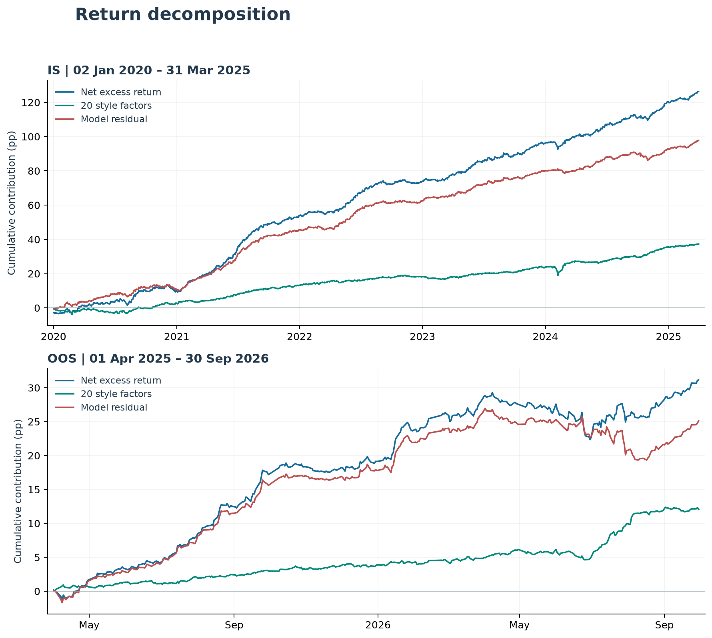
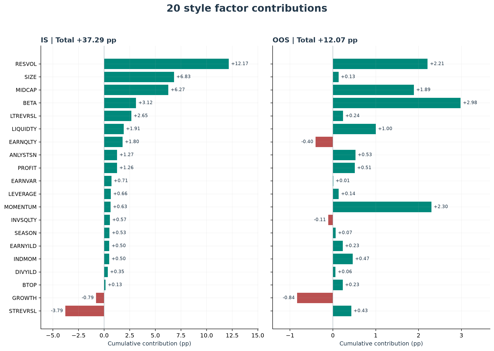
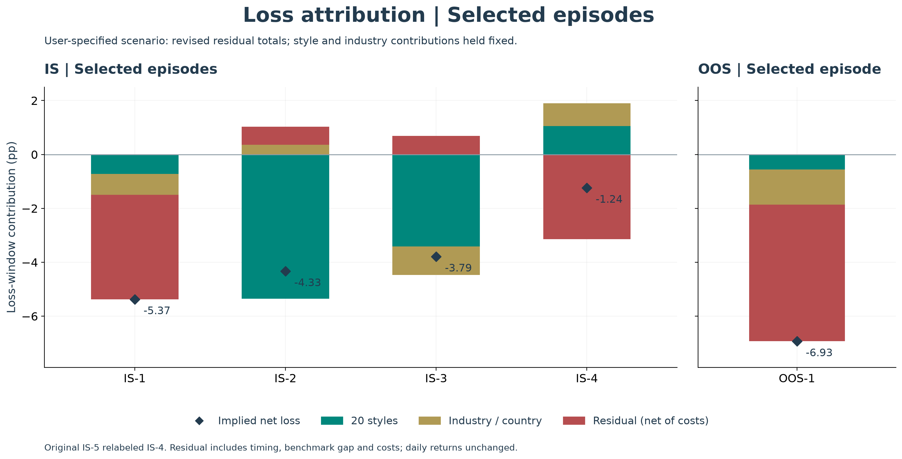
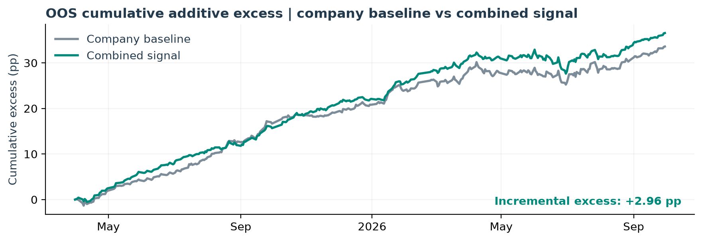

# Live_Signal

## Live Signal Tracking Methodology

- Model updates: Quarterly retraining; historical out-of-sample signals remain unchanged.
- Rebalancing: Daily, using VWAP of the first half hour as the assumed execution price.
- Exclusions: ST stocks, suspended stocks, stocks newly listed in the current quarter, and stocks with fewer than 40 trading days in the past 60 trading days.
- Transaction costs: Evaluated at 5 and 15 bps.
- Turnover: Reported on a one-way basis.
- Optimizer: Constrains active exposures to eight **Barra style factors to ±0.3** relative to the benchmark and penalizes risk using **stock-specific risk** and **Barra style-factor covariance**. Enforces full investment, long-only positions, a 0.5% per-stock weight cap, a 15% one-way turnover limit, and per-stock liquidity limits.

## Signal Performance

In sample period: January 2, 2020–September 30, 2026.  
OOS period: April 1, 2025–September 30, 2026.  

### Strategy, Benchmark and Excess Performance

| Metric | In-sample | OOS |
|---|---:|---:|
| Trading observations | 1,269 | 367 |
| Annualized arithmetic excess | 24.39% | 20.81% |
| Information ratio | 4.09 | 3.37 |
| Maximum additive excess drawdown | 4.37 pp | 6.93 pp |
| Positive excess months | 90.48% | 88.89% |

## Return Decomposition

### Cumulative Return Attribution

| Cumulative contribution (pp) | IS | OOS |
|---|---:|---:|
| 20 style factors | +37.29 | +12.07 |
| Industry / country | +5.43 | −0.74 |
| Model residual | +97.73 | +25.11 |
| Costs | −14.11 | −5.27 |
| **Net excess return** | **+126.33** | **+31.17** |

### Overall Return Decomposition

### Contributions from 20 Barra Style Factors

## Excess Return Drawdown Attribution

The table decomposes selected loss windows into 20 style factors, industry/country effects, and residual contributions. All values are in percentage points (pp); positive contributions offset losses.

This scenario uses revised residual assumptions while retaining the previous style and industry contributions. Total losses are the sum of these components, rather than maximum drawdowns recalculated from daily returns. Residual contributions include trading timing, benchmark differences, and transaction costs.

| Episode | Loss window | 20 style factors (pp) | Industry / country (pp) | Residual (pp) | Total loss (pp) |
|---|---|---:|---:|---:|---:|
| **OOS-1** | Apr 9–Jun 30, 2026 | −0.560 | −1.297 | −5.072 | **−6.930** |
| IS-1 | Dec 4, 2020–Jan 4, 2021 | −0.723 | −0.773 | −3.874 | **−5.370** |
| IS-2 | Jan 18–Feb 7, 2024 | −5.354 | +0.359 | +0.666 | **−4.329** |
| IS-3 | Jan 2–Feb 25, 2020 | −3.419 | −1.056 | +0.689 | **−3.786** |
| IS-4 | Sep 23–Oct 31, 2024 | +1.058 | +0.844 | −3.138 | **−1.235** |

*Totals use unrounded values. IS-4 refers to the episode previously labeled IS-5; the original IS-4 episode has been excluded.*

### Drawdown Decomposition

### Main Observations

- **OOS-1:** Residual losses account for approximately 73% of the total loss. Style and industry contributions are also negative.
- **IS-1:** Residual losses account for approximately 72% of the total loss, with additional losses from styles and industries.
- **IS-2:** Style factors dominate the loss. Positive industry and residual contributions partially offset the −5.354 pp style contribution.
- **IS-3:** Both style and industry exposures contribute negatively, while the residual provides a partial offset.
- **IS-4:** Positive style and industry contributions offset approximately 61% of the residual loss, leaving a total loss of 1.235 pp.

The revised IS-4 total is below 3 pp and is retained here for comparison.

## Part Two: Incremental Contribution

Sample period: January 2, 2020–September 30, 2026.  
OOS period: April 1, 2025–September 30, 2026.

### Improvement over the Company Baseline

| OOS metric | Company baseline | Combined signal | Change |
|---|---:|---:|---:|
| Annualized excess return | 21.42% | 24.38% | +2.96 pp |
| Information ratio | 3.74 | 4.52 | +0.78 |
| Maximum additive excess drawdown | 4.93 pp | 5.26 pp | +0.33 pp |
| Cumulative additive excess | 33.59 pp | 36.55 pp | +2.96 pp |

The combined signal delivers higher excess return and better
risk-adjusted performance than the company baseline. Tracking error
decreases, although maximum additive excess drawdown widens slightly.

Changes are calculated before rounding. Annualization assumes
250 trading days; pp denotes percentage points.

| Metric | In-sample | OOS | Full sample |
|---|---:|---:|---:|
| Trading observations | 1,269 | 367 | 1,636 |
| Daily excess-return correlation | 0.519 | 0.580 | 0.534 |
