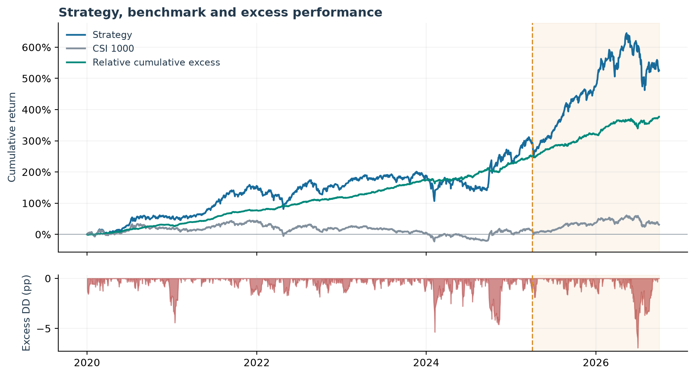
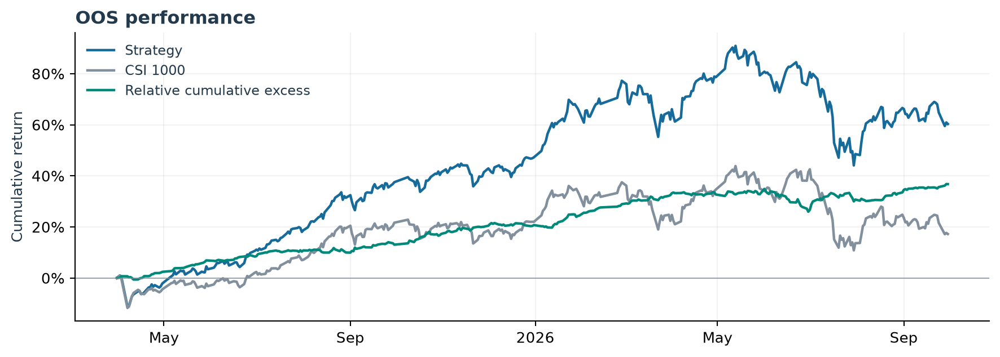
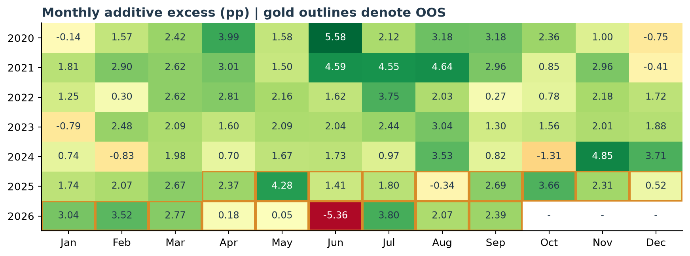
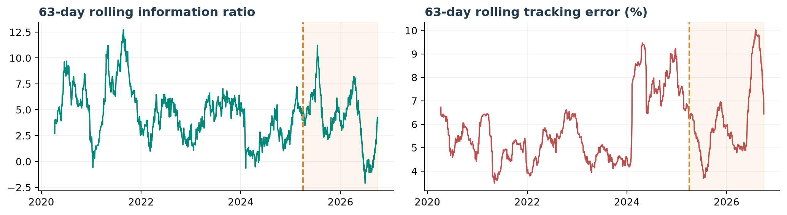

# Live_Signal

## Live Signal Tracking Methodology

- Model updates: Quarterly retraining; historical out-of-sample signals remain unchanged.
- Rebalancing: Daily, using full-day VWAP as the assumed execution price.
- Exclusions: ST stocks, suspended stocks, stocks newly listed in the current quarter, and stocks with fewer than 40 trading days in the past 60 trading days.
- Transaction costs: Evaluated at 5 and 15 bps.
- Turnover: Reported on a one-way basis.
- Optimizer: Constrains active exposures to eight **Barra style factors to ±0.3** relative to the benchmark and penalizes risk using **stock-specific risk** and **Barra style-factor covariance**. Enforces full investment, long-only positions, a 0.5% per-stock weight cap, a 15% one-way turnover limit, and per-stock liquidity limits.

## Signal Performance

Sample period: January 2, 2020–September 30, 2026.  
OOS period: April 1, 2025–September 30, 2026.  
Annualization assumes 245 trading days. October 2026 data is excluded.

### Strategy, Benchmark and Excess Performance

| Metric | In-sample | OOS |
|---|---:|---:|
| Trading observations | 1,269 | 367 |
| Strategy CAGR | 30.07% | 37.03% |
| CSI 1000 CAGR | 2.19% | 11.19% |
| Annualized arithmetic excess | 24.39% | 20.81% |
| Information ratio | 4.12 | 3.31 |
| Tracking error | 5.92% | 6.28% |
| Strategy NAV maximum drawdown | 31.32% | 24.53% |
| Maximum additive excess drawdown | 5.36 pp | 6.93 pp |
| Positive excess months | 90.48% | 88.89% |

Daily strategy returns are calculated as daily excess plus benchmark
returns. Strategy and benchmark curves are compounded. Relative cumulative
excess equals strategy wealth divided by benchmark wealth, minus one.
Additive excess drawdown is measured in percentage points (pp).

### Out-of-Sample Performance

The OOS segment generates 31.17 percentage points of cumulative additive
excess across 367 observations. Annualized arithmetic excess is 20.81%,
with an information ratio of 3.31.

Compared with in-sample results, annualized excess decreases by 3.58
percentage points, while tracking error increases from 5.92% to 6.28%.

### Monthly Consistency

Excess returns are positive in 16 of 18 OOS months. The strongest OOS
month is May 2025 (+4.28 pp); the weakest is June 2026 (-5.36 pp).
January–September 2026 contributes 12.46 pp of additive excess.

### Rolling Performance and Drawdown

The maximum OOS additive excess drawdown is 6.93 pp, from the
June 1, 2026 peak to the June 30, 2026 trough. The previous peak
is recovered on September 4, 2026.

At September 30, 2026, the trailing 63-day information ratio is 3.65,
compared with 3.31 for the full OOS period. Rolling windows use
63 observations and may span the IS/OOS boundary.

Illustrative supplied-series analysis. OOS denotes the specified date
segment, not independent live validation. The supplied return file does
not identify a transaction-cost scenario.
